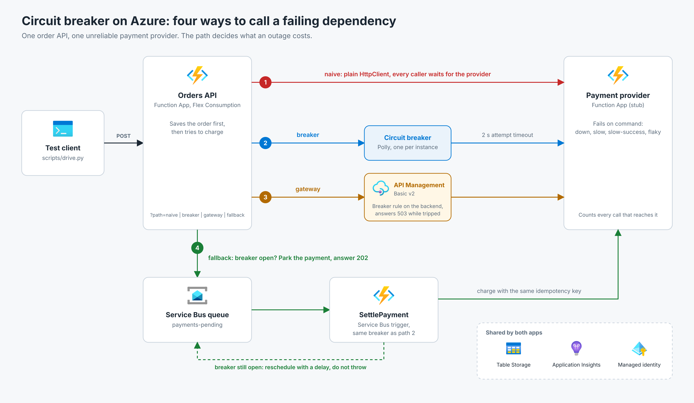

# circuit-breaker-azure

The circuit breaker pattern on Azure, with the part most samples skip: what happens to the order when the payment service is down.

Companion to the Cloud Perspectives post [Circuit Breaker Pattern on Azure: The Breaker Opens, the Order Still Exists](docs/blog-circuit-breaker-azure.md).



## What is in here

| Part | What it does |
|---|---|
| `src/Orders` | .NET 8 isolated Function App. Order API with four payment paths, plus a Service Bus triggered function that settles parked payments. |
| `src/PaymentStub` | .NET 8 isolated Function App. A payment provider that fails on command and counts every call that reaches it. |
| `infra` | Bicep: two Flex Consumption apps, Service Bus Standard, Storage, Application Insights, a user-assigned identity and (optional) API Management Basic v2 with a backend circuit breaker rule. No keys or connection strings. |
| `scripts/drive.py` | Runs eight outage scenarios and checks the outcome of each. Python standard library only. |
| `docs/queries.kql` | KQL for circuit transitions, dependency calls and settlements. |
| `images/make_diagrams.py` | Draws the three diagrams from the Azure Public Service Icons set. |

## The four paths

`POST {ORDERS_URL}/orders?path=<path>&runId=<any>`

| Path | Breaker | Order when payment fails |
|---|---|---|
| `naive` | none, plain `HttpClient` | `PaymentFailed`, HTTP 503 after waiting for the provider |
| `breaker` | Polly, in the process | `PaymentFailed`, HTTP 503 with `Retry-After` |
| `gateway` | API Management backend rule | `PaymentFailed`, HTTP 503 |
| `fallback` | Polly, plus a Service Bus queue | `PaymentPending`, HTTP 202, paid after recovery |

Other endpoints of the orders app: `GET /summary?runId=`, `GET /orders/{runId}/{orderId}`, `GET /breaker` (state of the instance that answers), `GET /queue` (active, scheduled and dead-lettered messages).

Payment stub: `POST /control/mode` with `{"mode": "healthy|down|slow|slow-success|flaky", "delayMs": 8000, "failureRate": 0.5}`, `GET /control/stats?runId=`.

## Deploy

Prerequisites: Azure Developer CLI, Azure CLI, .NET 8 SDK, Python 3.10 or later for the test script.

```powershell
azd auth login
azd env new circuit-breaker
azd env set AZURE_LOCATION swedencentral
azd up
```

API Management Basic v2 is part of the deployment by default and has a fixed hourly price. To leave it out, set the parameter before `azd up`; the `gateway` path then answers 501 and the script skips it:

```powershell
azd env config set infra.parameters.deployApim false
```

## Run the scenarios

```powershell
python scripts/drive.py              # all eight, roughly 15 minutes
python scripts/drive.py --list
python scripts/drive.py --only fallback,requeue
```

The script reads `ORDERS_URL` and `PAYMENT_URL` from the azd environment, prints the measurements per scenario, writes `results/drive-results.json` and always sets the provider back to healthy.

| Scenario | Provider mode | Proves |
|---|---|---|
| `baseline` | healthy | every path pays |
| `naive` | slow (8 s, then 503) | without a breaker every caller waits and every call reaches the provider |
| `breaker` | slow | after a few slow calls the rest fail fast; one circuit per instance |
| `gateway` | down | API Management answers 503 itself while tripped |
| `fallback` | down, then healthy | 100 orders accepted, all paid after recovery, exactly 100 charges |
| `requeue` | down | a consumer that throws dead-letters every message; rescheduling dead-letters none |
| `ambiguous` | slow-success | the caller timed out but the provider charged; the idempotency key prevents the second charge |
| `recovery` | down, then healthy | how long callers are rejected after the provider is healthy again |

## Breaker settings

App settings on the orders app (`infra/resources.bicep`). The values are small so the demo trips and recovers in seconds. They are not production defaults.

| Setting | Value | Meaning |
|---|---|---|
| `BREAKER_FAILURE_RATIO` | 0.5 | share of failed calls that opens the circuit |
| `BREAKER_MINIMUM_THROUGHPUT` | 10 | calls needed in the window before the ratio counts |
| `BREAKER_SAMPLING_SECONDS` | 10 | sampling window |
| `BREAKER_BREAK_SECONDS` | 15 | time the circuit stays open before a probe |
| `PAYMENT_ATTEMPT_TIMEOUT_SECONDS` | 2 | attempt timeout inside the breaker |
| `SETTLE_MAX_ATTEMPTS` | 20 | reschedules before a parked payment is dead-lettered |

`scripts/drive.py` has `BREAK_SECONDS` and `ATTEMPT_TIMEOUT_SECONDS` at the top. Change them together with the app settings.

## Known gaps, on purpose

- All HTTP endpoints are anonymous and the API Management API needs no subscription key. This is a demo. Delete it when you are done.
- Saving a pending order and sending its queue message are two operations. A transactional outbox closes that gap.
- The stub counts calls with one table row per call. Fine for a few thousand calls, not a pattern to copy.

## Redraw the diagrams

```powershell
python images/make_diagrams.py "C:\path\to\Azure_Public_Service_Icons\Icons"
```

PNG output needs `rsvg-convert` on PATH; without it the script writes SVG only.

## Clean up

```powershell
azd down --purge
```
